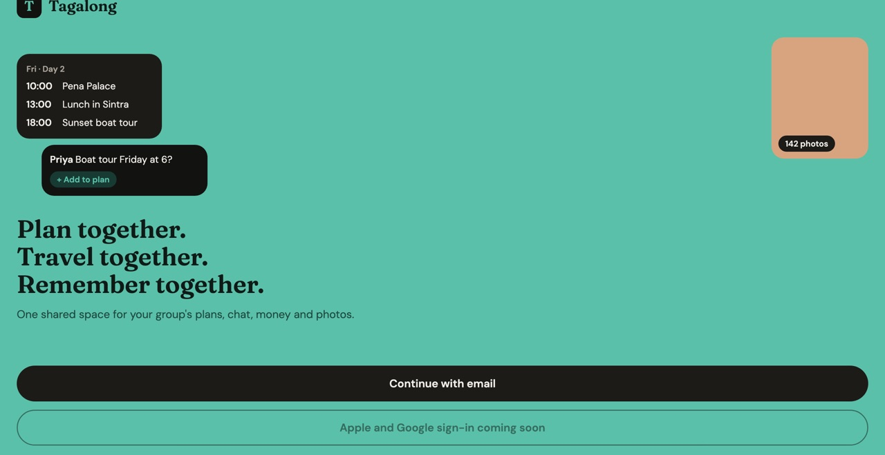
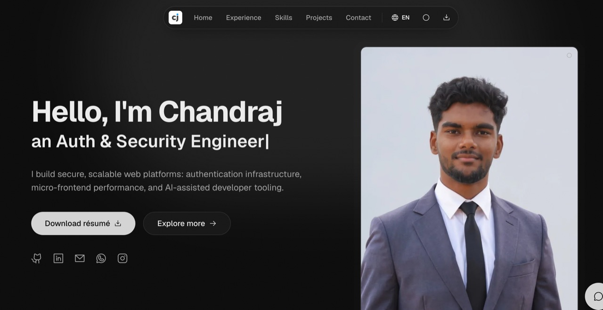

<picture>
  <source media="(prefers-color-scheme: dark)" srcset="assets/banner-dark.svg">
  
</picture>

  
  
  

I build secure, scalable products: authentication and access control, real-time apps, and AI tooling that speeds up engineering teams. By day I work on identity and the core platform at Contentstack; on the side I ship apps like Tagalong.

- **Building** [Tagalong](https://github.com/ChandrajCJ/tagalong), a real-time group trip planner for Android, iOS and the web
- **At work:** granular RBAC, OAuth 2.0, a login service across 7 production environments, and AI agents for support and code review
- **Exploring:** self-hosted LLMs, React Native, real-time systems

## Featured work

<table>
  <tr>
    <td width="50%" valign="top">
      
      <h3><a href="https://github.com/ChandrajCJ/tagalong">Tagalong</a></h3>
      
Group trip planner: a live shared itinerary, group chat, expense splitting and shared photo albums. Offline first, with self-hosted AI and 450+ automated tests.

      
TypeScript · React Native · Fastify · PostgreSQL · Redis · WebSockets · Ollama

      <a href="https://tagalong-u4wh.onrender.com/"><b>Live</b></a> · <a href="https://github.com/ChandrajCJ/tagalong"><b>Code</b></a>
    </td>
    <td width="50%" valign="top">
      
      <h3><a href="https://github.com/ChandrajCJ/CJPortfolio">Portfolio</a></h3>
      
Six languages with right-to-left Arabic, a 3D globe and contribution skyline, scroll-drawn illustrations, and Astro, an AI assistant that answers questions about my work.

      
React · Vite · Tailwind CSS · Framer Motion · Three.js · Netlify Functions · Gemini

      <a href="https://developedbycj.netlify.app/?ref=github"><b>Live</b></a> · <a href="https://github.com/ChandrajCJ/CJPortfolio"><b>Code</b></a>
    </td>
  </tr>
</table>

**Also built**

- [Real-time chat app](https://github.com/ChandrajCJ/chat-app-2): 1:1 messaging with voice notes, reactions and read receipts, on Firebase
- [Eventify](https://github.com/ChandrajCJ/Eventify): an event app on Next.js, TypeScript and Contentstack
- [DSA](https://github.com/ChandrajCJ/DSA): data structures and algorithms practice in Python

## Toolbox

<picture>
  <source media="(prefers-color-scheme: dark)" srcset="https://skillicons.dev/icons?i=ts%2Cjs%2Creact%2Cnextjs%2Cnodejs%2Cnestjs%2Cpostgres%2Cmongodb%2Credis%2Cfirebase%2Cdocker%2Ckubernetes%2Caws%2Cazure%2Ctailwind%2Cpython&perline=16&theme=dark">
  
</picture>

Plus OAuth 2.0, SSO, SAML, OIDC, SCIM, RBAC, OPA and MFA on the security side, and RAG, LangChain and AI agents on the AI side.

## Activity

<picture>
  <source media="(prefers-color-scheme: dark)" srcset="https://raw.githubusercontent.com/ChandrajCJ/ChandrajCJ/output/github-snake-dark.svg">
  
</picture>
